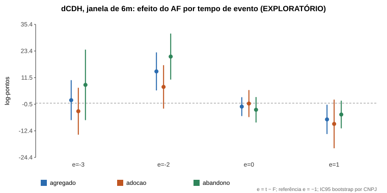
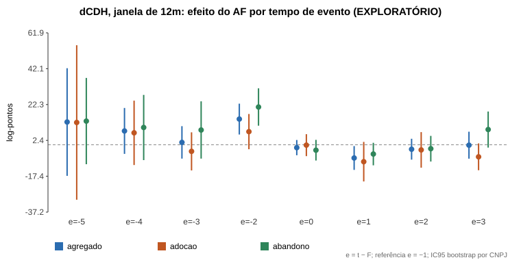
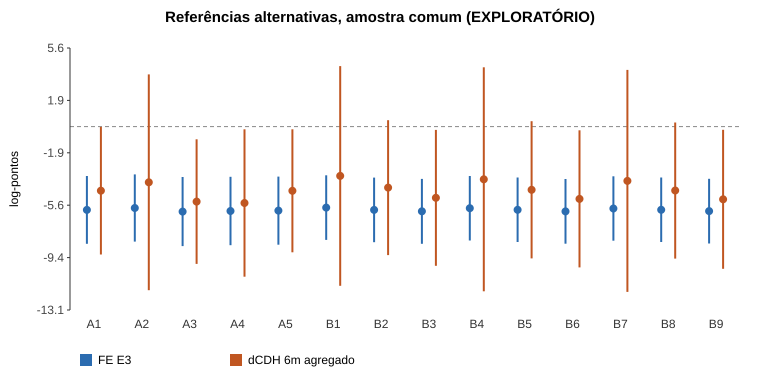

# Efeito do modo de disputa (Aberto × Aberto-Fechado) na cesta padronizada

Gerado em 25/11/2026 09:53 por `executar.py` (versão 1.0.0). Protocolo: [`protocolo.md`](protocolo.md) (fixado antes da estimação); método: [`metodologia.md`](metodologia.md); conclusão: [`conclusao.md`](conclusao.md); alterações após o registro: [`desvios_registro.md`](desvios_registro.md).

> **Todos os resultados abaixo são EXPLORATÓRIOS.** A cesta validada não tem nenhum produto aprovado (0 aprovados; 0 decisões no formulário). A análise principal, que exige aprovação técnica documentada, não pôde ser executada; as estimativas usam a cesta candidata e não devem ser lidas como confirmação causal.

## 1. Produtos aprovados e conjuntos da cesta

| Conjunto | Produtos |
|---|---|
| Cesta candidata | 16.248 |
| Classe A | 10.424 |
| Classe B | 5.824 |
| Famílias do cenário rigoroso | 6.216 |
| Produtos candidatos nessas famílias | 6.217 |
| A ∩ rigoroso | 4.122 |
| B ∩ rigoroso | 2.095 |
| A fora do rigoroso | 6.302 |
| Produtos recorrentes em todas as janelas | 14.544 |
| **Aprovados (cesta validada)** | **0** |

## 2. Amostra, funil e auditoria

| Etapa | Critério | Itens | Compras | Produtos | UASGs | Órgãos (CNPJ) |
|---|---|---|---|---|---|---|
| 0_cesta_candidata | Itens licitados dos produtos da cesta candidata | 2.137.650 | 129.906 | 16.248 | 4.587 | 2.534 |
| 1_compras_gov_pregao_eletronico | Compras.gov.br, Pregão Eletrônico (já garantido pela cesta; conferido na ligação) | 2.137.650 | 129.906 | 16.248 | 4.587 | 2.534 |
| 2_modo_A_ou_AF | Modo Aberto ou Aberto-Fechado | 2.124.004 | 129.012 | 16.248 | 4.580 | 2.530 |
| 3_menor_preco | Critério de julgamento Menor preço | 2.106.560 | 127.626 | 16.248 | 4.562 | 2.520 |
| 4_data_abertura_valida | Data de abertura válida (define o trimestre) | 2.106.560 | 127.626 | 16.248 | 4.562 | 2.520 |
| 5_homologado | Item homologado | 1.671.032 | 112.859 | 16.247 | 4.435 | 2.447 |
| 6_preco_positivo | Preço unitário homologado positivo | 1.671.008 | 112.857 | 16.247 | 4.435 | 2.447 |
| 7_produto_aprovado | Produto com aprovação técnica documentada (cesta validada) | 0 | 0 | 0 | 0 | 0 |

- Ligação ao `pncp_v2.db` por (`numero_controle_pncp`, `numero_item`, `registro_principal = 1`): todos os 2.137.650 itens ligados, um registro por item, CATMAT, CNPJ e data de publicação iguais aos da cesta; as divergências de UASG eram só zeros à esquerda (normalizado para 6 dígitos). Ver `tabelas/impressoes_digitais.json` (fontes inalteradas).
- Referência A1 disponível (≥ 5 itens de ≥ 3 outras UASGs): 1.357.107 itens; depois da regra `|Y| ≤ ln 10`: **1.308.331 itens** na amostra exploratória (A1).

## 3. Cobertura temporal e censura

| Trimestre de abertura | Itens | Compras | Homologados | Com preço | Situação |
|---|---|---|---|---|---|
| 2022T4 | 343 | 51 | 0 | 0 | incompleto (censura/fonte) |
| 2023T1 | 2.997 | 195 | 0 | 0 | completo |
| 2023T2 | 26.701 | 1.631 | 18.786 | 17.812 | completo |
| 2023T3 | 72.784 | 3.882 | 54.491 | 52.762 | completo |
| 2023T4 | 90.288 | 4.882 | 69.221 | 68.197 | completo |
| 2024T1 | 114.617 | 5.542 | 92.080 | 90.876 | completo |
| 2024T2 | 221.694 | 13.656 | 179.574 | 177.005 | completo |
| 2024T3 | 253.313 | 16.529 | 201.961 | 199.545 | completo |
| 2024T4 | 266.177 | 16.856 | 211.620 | 208.429 | completo |
| 2025T1 | 202.898 | 11.303 | 162.689 | 160.407 | completo |
| 2025T2 | 216.265 | 13.860 | 173.476 | 170.197 | completo |
| 2025T3 | 255.789 | 16.340 | 204.526 | 202.618 | completo |
| 2025T4 | 214.525 | 13.877 | 171.688 | 169.826 | completo |
| 2026T1 | 154.601 | 8.849 | 121.503 | 120.255 | completo |
| 2026T2 | 43.657 | 2.383 | 33.058 | 32.675 | incompleto (censura/fonte) |
| 2026T3 | 898 | 63 | 404 | 404 | fora da cobertura do CATMAT |
| 2026T4 | 103 | 7 | 0 | 0 | fora da cobertura do CATMAT |

- O CATMAT some da fonte depois de 17/04/2026 (censura da fonte): 2026T2 é incompleto e 2026T3–T4 não são observados — não são trimestres sem compras.
- 2023T1 não tem itens com situação Homologado: a API mantém 'Em andamento' em itens com preço de resultado (status desatualizado). O preço só existe a partir de 2023T2; o regime de modo usa 2023T1.

## 4. Eventos e identificação

| Medida | Valor |
|---|---|
| Painel (regime) | 2023T1–2026T1 |
| UASGs no painel | 5.355 |
| Trocas válidas (A→AF / AF→A) | 317 (172 / 145) |
| Trocas puras / absorventes | 96 / 212 |
| Irregulares (fora) / sem pré adjacente (fora) | 610 / 120 |
| CNPJs com troca | 187 |
| Eventos usados em l = 1 (principal) | 145 |
| CNPJs usados / nº efetivo de CNPJs | 103 / 15,1 |
| Participação do maior CNPJ / das 5 maiores UASGs no peso | 21,1% / 15,8% |
| Eventos com placebo l = −1 / −2 | 86 / 59 |
| Sobreposição de produtos pré/pós (média) | 2,6% |
| Trimestre do ano das trocas | {'1': 54, '2': 81, '3': 110, '4': 72} |

As referências de auditoria (995 UASGs com os dois modos; ~160 eventos potenciais) usavam outra regra; a regra deste protocolo identifica 317 trocas persistentes.

Balanço (mesmo estimador dCDH aplicado às características; diferença associada à troca, sinal 'efeito do AF'):

| Característica | Grupo | l | Estimativa | IC95 | p |
|---|---|---|---|---|---|
| logq | abandono | media | 0,223 | [-0,45; 0,90] | 0,517 |
| logq | abandono | -1 | -0,370 | [-1,00; 0,26] | 0,248 |
| logq | adocao | media | 0,089 | [-0,43; 0,61] | 0,736 |
| logq | adocao | -1 | 0,304 | [-0,18; 0,79] | 0,216 |
| logq | agregado | media | 0,153 | [-0,22; 0,53] | 0,422 |
| logq | agregado | -1 | -0,049 | [-0,42; 0,32] | 0,797 |
| srp_f | abandono | media | -0,074 | [-0,17; 0,02] | 0,126 |
| srp_f | abandono | -1 | -0,054 | [-0,13; 0,02] | 0,152 |
| srp_f | adocao | media | -0,001 | [-0,04; 0,03] | 0,936 |
| srp_f | adocao | -1 | -0,011 | [-0,06; 0,04] | 0,671 |
| srp_f | agregado | media | -0,036 | [-0,09; 0,02] | 0,167 |
| srp_f | agregado | -1 | -0,033 | [-0,08; 0,01] | 0,169 |
| sigilo_f | abandono | media | 0,041 | [-0,05; 0,13] | 0,361 |
| sigilo_f | abandono | -1 | -0,009 | [-0,02; 0,01] | 0,234 |
| sigilo_f | adocao | media | 0,017 | [-0,02; 0,05] | 0,330 |
| sigilo_f | adocao | -1 | -0,008 | [-0,02; 0,01] | 0,266 |
| sigilo_f | agregado | media | 0,028 | [-0,02; 0,08] | 0,236 |
| sigilo_f | agregado | -1 | -0,009 | [-0,02; 0,00] | 0,096 |
| homolog_f | abandono | media | -0,017 | [-0,09; 0,06] | 0,661 |
| homolog_f | abandono | -1 | 0,061 | [-0,04; 0,17] | 0,248 |
| homolog_f | adocao | media | -0,005 | [-0,05; 0,04] | 0,834 |
| homolog_f | adocao | -1 | 0,016 | [-0,02; 0,05] | 0,407 |
| homolog_f | agregado | media | -0,011 | [-0,05; 0,03] | 0,617 |
| homolog_f | agregado | -1 | 0,040 | [-0,02; 0,10] | 0,177 |

## 5. Estatísticas descritivas por modo (Y_A1, log-pontos)

| Modo | Itens | Compras | Produtos | UASGs | Órgãos | Média | Mediana | DP | P5 | P25 | P75 | P95 | Homolog. (decididos) | Fracasso | Deserção |
|---|---|---|---|---|---|---|---|---|---|---|---|---|---|---|---|
| Aberto | 844.255 | 62.728 | 15.704 | 3.258 | 1.838 | -1,81 | -4,41 | 60,76 | -98,26 | -29,74 | 23,60 | 105,44 | 82,9% | 9,5% | 3,0% |
| Aberto-Fechado | 464.076 | 36.046 | 15.587 | 1.897 | 1.046 | -6,76 | -8,12 | 60,20 | -103,16 | -34,24 | 18,04 | 97,72 | 81,2% | 10,9% | 3,6% |

| Diferença bruta (AF − A) | lp | % exato | IC95 (CNPJ) | p CNPJ | p 2 vias | p WCR | Órgãos (efetivos) |
|---|---|---|---|---|---|---|---|
| Y_A1 (log-pontos) | -4,95 | -4,83 | [-9,13; -0,78] | 0,020 | 0,020 | 0,037 | 2.378 (27) |
| log preço homologado ×100 (sem referência) | 2,25 | 2,27 | [-8,78; 13,28] | 0,690 | 0,691 | 0,725 | 2.378 (27) |
| diferença de medianas de Y_A1 | -3,71 | -3,64 | [-6,74; -0,68] | — | — | — | 2.378 (—) |

## 6. Painel de efeitos fixos — associação condicional

| Espec. | Descrição | β (lp) | % exato | IC95 CNPJ | p | p 2 vias | p WCR | Itens | UASGs | Órgãos (efet.) | Perda singletons |
|---|---|---|---|---|---|---|---|---|---|---|---|
| E1 | bruto (sem efeitos fixos) | -4,95 | -4,83 | [-9,13; -0,78] | 0,020 | — | 0,037 | 1.308.331 | 4.315 | 2.378 (27) | 0 |
| E2 | UASG + produto×trimestre | -6,91 | -6,67 | [-8,80; -5,01] | 0,000 | — | — | 1.307.815 | 4.129 | 2.279 (23) | 516 |
| E3 | UASG + produto×trimestre + log quantidade (PRINCIPAL) | -5,96 | -5,79 | [-8,39; -3,53] | 0,000 | 0,000 | 0,001 | 1.307.815 | 4.129 | 2.279 (23) | 516 |
| E4 | E3 + SRP (decisão possivelmente conjunta) | -5,97 | -5,79 | [-8,39; -3,54] | 0,000 | — | — | 1.307.815 | 4.129 | 2.279 (23) | 516 |
| E5 | E3 + orçamento sigiloso (decisão possivelmente conjunta) | -5,88 | -5,71 | [-8,31; -3,46] | 0,000 | — | — | 1.307.815 | 4.129 | 2.279 (24) | 516 |
| E6 | E3 + SRP + sigilo | -5,89 | -5,72 | [-8,31; -3,47] | 0,000 | — | — | 1.307.815 | 4.129 | 2.279 (24) | 516 |
| E7 | UASG×produto + produto×trimestre + log quantidade | -2,86 | -2,82 | [-5,90; 0,17] | 0,065 | — | 0,189 | 738.791 | 3.423 | 1.879 (14) | 569.540 |
| E8 | UASG + produto×mês + log quantidade | -5,81 | -5,65 | [-7,86; -3,76] | 0,000 | — | — | 1.271.108 | 4.117 | 2.274 (25) | 37.223 |
| E9 | UASG + órgão×ano + produto×trimestre + log quantidade | -6,18 | -5,99 | [-8,64; -3,72] | 0,000 | — | — | 1.307.567 | 4.113 | 2.250 (17) | 764 |
| E10_tercil1 | E3 restrito ao tercil 1 da quantidade dentro do produto | -7,60 | -7,32 | [-10,17; -5,03] | 0,000 | — | — | 430.442 | 3.743 | 2.095 (25) | 10.891 |
| E10_tercil2 | E3 restrito ao tercil 2 da quantidade dentro do produto | -5,89 | -5,72 | [-8,51; -3,27] | 0,000 | — | — | 419.135 | 3.614 | 1.993 (22) | 11.833 |
| E10_tercil3 | E3 restrito ao tercil 3 da quantidade dentro do produto | -4,25 | -4,16 | [-6,92; -1,59] | 0,002 | — | — | 424.585 | 3.221 | 1.718 (27) | 11.445 |
| E3_sem_trimestres_incompletos | E3 sem 2022T4 e 2026T2 | -5,93 | -5,76 | [-8,38; -3,48] | 0,000 | — | — | 1.295.671 | 4.118 | 2.272 (24) | 516 |

Maiores contribuintes para a variação identificadora de E3 (exclusão exata e re-estimação):

| CNPJ | Participação | β sem o órgão |
|---|---|---|
| 00394452000103 | 18,3% | -5,31 |
| 76416932000181 | 5,4% | -7,28 |
| 00394502000144 | 3,1% | -6,11 |
| 96291141000180 | 2,8% | -6,02 |
| 15126437000143 | 2,5% | -6,07 |
| 42498733000148 | 1,6% | -6,20 |
| 87252045000131 | 1,6% | -5,82 |
| 76416940000128 | 1,3% | -6,34 |
| 10806496000149 | 1,3% | -6,04 |
| 46374500000194 | 1,3% | -5,99 |

## 7. Estudo de eventos (dCDH) — análise causal exploratória

| Especificação | Grupo | l | β (lp) | % exato | IC95 (bootstrap CNPJ) | p | p Holm (família) | DMD 80% |
|---|---|---|---|---|---|---|---|---|
| dcdh_6m_item_celula | abandono | media | -4,09 | -4,01 | [-9,07; 0,89] | 0,108 | 0,215 | 7,12 |
| dcdh_6m_item_celula | adocao | media | -5,05 | -4,93 | [-12,30; 2,19] | 0,172 | 0,215 | 10,36 |
| dcdh_6m_item_celula | agregado | media | -4,58 | -4,48 | [-9,15; -0,02] | 0,049 | 0,148 | 6,53 |
| dcdh_6m_item_celula | simetria | media | -0,96 | -0,96 | [-9,29; 7,37] | 0,821 | 0,821 | 11,91 |
| dcdh_6m_item_evento | abandono | media | -6,39 | -6,19 | [-17,21; 4,44] | 0,248 |  | 15,47 |
| dcdh_6m_item_evento | adocao | media | -2,37 | -2,34 | [-12,68; 7,93] | 0,652 |  | 14,73 |
| dcdh_6m_item_evento | agregado | media | -4,24 | -4,16 | [-11,76; 3,27] | 0,268 |  | 10,74 |
| dcdh_6m_item_evento | simetria | media | 4,01 | 4,10 | [-10,65; 18,68] | 0,592 |  | 20,96 |
| dcdh_6m_compra_celula | abandono | media | -0,21 | -0,21 | [-5,45; 5,03] | 0,938 |  | 7,49 |
| dcdh_6m_compra_celula | adocao | media | -4,48 | -4,38 | [-12,79; 3,84] | 0,291 |  | 11,88 |
| dcdh_6m_compra_celula | agregado | media | -2,01 | -1,99 | [-6,31; 2,29] | 0,360 |  | 6,15 |
| dcdh_6m_compra_celula | simetria | media | -4,27 | -4,18 | [-14,56; 6,02] | 0,416 |  | 14,71 |
| dcdh_12m_item_celula | abandono | media | -1,18 | -1,17 | [-6,35; 4,00] | 0,655 |  | 7,40 |
| dcdh_12m_item_celula | adocao | media | -5,04 | -4,91 | [-11,48; 1,40] | 0,125 |  | 9,21 |
| dcdh_12m_item_celula | agregado | media | -3,15 | -3,10 | [-7,58; 1,27] | 0,162 |  | 6,32 |
| dcdh_12m_item_celula | simetria | media | -3,86 | -3,79 | [-11,62; 3,90] | 0,330 |  | 11,10 |
| dcdh_12m_item_evento | abandono | media | -3,73 | -3,66 | [-13,32; 5,87] | 0,446 |  | 13,71 |
| dcdh_12m_item_evento | adocao | media | -4,35 | -4,26 | [-14,47; 5,77] | 0,400 |  | 14,47 |
| dcdh_12m_item_evento | agregado | media | -4,06 | -3,98 | [-11,16; 3,04] | 0,263 |  | 10,15 |
| dcdh_12m_item_evento | simetria | media | -0,62 | -0,62 | [-14,22; 12,97] | 0,928 |  | 19,44 |
| dcdh_12m_compra_celula | abandono | media | 1,18 | 1,19 | [-4,24; 6,60] | 0,669 |  | 7,74 |
| dcdh_12m_compra_celula | adocao | media | -5,19 | -5,06 | [-12,45; 2,08] | 0,162 |  | 10,38 |
| dcdh_12m_compra_celula | agregado | media | -1,47 | -1,46 | [-5,66; 2,73] | 0,493 |  | 6,00 |
| dcdh_12m_compra_celula | simetria | media | -6,37 | -6,17 | [-15,70; 2,96] | 0,181 |  | 13,34 |
| bjs_6m_item | adocao_absorvente | 1 | -5,00 | -4,87 | [-11,33; 1,33] | 0,122 |  | — |
| bjs_6m_item | adocao_absorvente | 2 | -14,91 | -13,85 | [-27,45; -2,36] | 0,020 |  | — |
| bjs_6m_item | adocao_absorvente | media | -10,42 | -9,90 | [-18,53; -2,32] | 0,012 |  | — |

Trajetória dinâmica e placebos (principal):

| Grupo | l (e = l−1) | β (lp) | IC95 | p | DMD 80% |
|---|---|---|---|---|---|
| abandono | -1 | 20,91 | [10,57; 31,24] | 0,000 | 14,77 |
| abandono | -2 | 8,20 | [-7,64; 24,04] | 0,310 | 22,64 |
| abandono | 1 | -2,98 | [-8,69; 2,73] | 0,306 | 8,16 |
| abandono | 2 | -5,11 | [-11,33; 1,11] | 0,107 | 8,88 |
| adocao | -1 | 7,29 | [-2,46; 17,04] | 0,143 | 13,94 |
| adocao | -2 | -3,63 | [-14,18; 6,91] | 0,499 | 15,07 |
| adocao | 1 | -0,19 | [-6,25; 5,87] | 0,951 | 8,66 |
| adocao | 2 | -9,34 | [-20,27; 1,59] | 0,094 | 15,62 |
| agregado | -1 | 14,24 | [5,71; 22,77] | 0,001 | 12,19 |
| agregado | -2 | 1,34 | [-7,63; 10,32] | 0,769 | 12,83 |
| agregado | 1 | -1,57 | [-5,79; 2,66] | 0,467 | 6,04 |
| agregado | 2 | -7,30 | [-13,88; -0,72] | 0,030 | 9,40 |





## 8. HonestDiD

| Especificação | Família | Valor | IC robusto | Inclui zero | Erro/observação |
|---|---|---|---|---|---|
| dcdh_6m_item_celula/agregado | original | — | [-8,95; 0,08] | True |  |
| dcdh_6m_item_celula/agregado | RM | 0.0 | [-8,90; 0,05] | True |  |
| dcdh_6m_item_celula/agregado | RM | 0.5 | [-22,35; 14,06] | True |  |
| dcdh_6m_item_celula/agregado | RM | 1.0 | [-39,31; 31,02] | True |  |
| dcdh_6m_item_celula/agregado | RM | 1.5 | [-46,04; 46,04] | True |  |
| dcdh_6m_item_celula/agregado | RM | 2.0 | [-46,04; 46,04] | True |  |
| dcdh_6m_item_celula/agregado | SD | 0.0 | [-10,00; 8,14] | True |  |
| dcdh_6m_item_celula/agregado | SD | 0.5 | [-10,35; 8,49] | True |  |
| dcdh_6m_item_celula/agregado | SD | 1.0 | [-11,30; 9,43] | True |  |
| dcdh_6m_item_celula/agregado | SD | 2.0 | [-12,13; 13,58] | True |  |
| dcdh_6m_item_celula/adocao | original | — | [-11,68; 2,15] | True |  |
| dcdh_6m_item_celula/adocao | RM | 0.0 | [-11,65; 2,05] | True |  |
| dcdh_6m_item_celula/adocao | RM | 0.5 | [-20,26; 13,34] | True |  |
| dcdh_6m_item_celula/adocao | RM | 1.0 | [-33,67; 27,74] | True |  |
| dcdh_6m_item_celula/adocao | RM | 1.5 | [-48,07; 42,14] | True |  |
| dcdh_6m_item_celula/adocao | RM | 2.0 | [-62,61; 56,82] | True |  |
| dcdh_6m_item_celula/adocao | SD | 0.0 | [-21,73; 0,37] | True |  |
| dcdh_6m_item_celula/adocao | SD | 0.5 | [-22,07; 0,72] | True |  |
| dcdh_6m_item_celula/adocao | SD | 1.0 | [-23,04; 1,68] | True |  |
| dcdh_6m_item_celula/adocao | SD | 2.0 | [-24,06; 5,98] | True |  |
| dcdh_6m_item_celula/abandono | original | — | [-9,04; 0,95] | True |  |
| dcdh_6m_item_celula/abandono | RM | 0.0 | [-8,93; 0,87] | True |  |
| dcdh_6m_item_celula/abandono | RM | 0.5 | [-28,01; 19,03] | True |  |
| dcdh_6m_item_celula/abandono | RM | 1.0 | [-49,74; 40,66] | True |  |
| dcdh_6m_item_celula/abandono | RM | 1.5 | [-50,96; 50,96] | True |  |
| dcdh_6m_item_celula/abandono | RM | 2.0 | [-50,96; 50,96] | True |  |
| dcdh_6m_item_celula/abandono | SD | 0.0 | [0,83; 25,17] | False |  |
| dcdh_6m_item_celula/abandono | SD | 0.5 | [0,61; 25,38] | False |  |
| dcdh_6m_item_celula/abandono | SD | 1.0 | [-0,02; 26,02] | True |  |
| dcdh_6m_item_celula/abandono | SD | 2.0 | [-0,13; 29,93] | True |  |
| dcdh_12m_item_celula/agregado | original | — | [-7,43; 1,67] | True |  |
| dcdh_12m_item_celula/agregado | RM | 0.0 | [-7,39; 1,63] | True |  |
| dcdh_12m_item_celula/agregado | RM | 0.5 | [-43,43; 36,00] | True |  |
| dcdh_12m_item_celula/agregado | RM | 1.0 | [-46,41; 46,41] | True |  |
| dcdh_12m_item_celula/agregado | RM | 1.5 | [-46,41; 46,41] | True |  |
| dcdh_12m_item_celula/agregado | RM | 2.0 | [-46,41; 46,41] | True |  |
| dcdh_12m_item_celula/agregado | SD | 0.0 | [-10,31; 10,71] | True |  |
| dcdh_12m_item_celula/agregado | SD | 0.5 | [-10,99; 14,13] | True |  |
| dcdh_12m_item_celula/agregado | SD | 1.0 | [-13,88; 18,16] | True |  |
| dcdh_12m_item_celula/agregado | SD | 2.0 | [-17,77; 27,57] | True |  |
| dcdh_12m_item_celula/adocao | original | — | [-11,03; 1,54] | True |  |
| dcdh_12m_item_celula/adocao | RM | 0.0 | [-10,98; 1,48] | True |  |
| dcdh_12m_item_celula/adocao | RM | 0.5 | [-62,74; 50,67] | True |  |
| dcdh_12m_item_celula/adocao | RM | 1.0 | [-64,16; 64,16] | True |  |
| dcdh_12m_item_celula/adocao | RM | 1.5 | [-64,16; 64,16] | True |  |
| dcdh_12m_item_celula/adocao | RM | 2.0 | [-64,16; 64,16] | True |  |
| dcdh_12m_item_celula/adocao | SD | 0.0 | [-21,39; 6,60] | True |  |
| dcdh_12m_item_celula/adocao | SD | 0.5 | [-23,10; 8,31] | True |  |
| dcdh_12m_item_celula/adocao | SD | 1.0 | [-26,70; 11,43] | True |  |
| dcdh_12m_item_celula/adocao | SD | 2.0 | [-33,88; 18,09] | True |  |
| dcdh_12m_item_celula/abandono | original | — | [-5,72; 4,83] | True |  |
| dcdh_12m_item_celula/abandono | RM | 0.0 | [-5,66; 4,80] | True |  |
| dcdh_12m_item_celula/abandono | RM | 0.5 | [-38,64; 37,35] | True |  |
| dcdh_12m_item_celula/abandono | RM | 1.0 | [-53,84; 53,84] | True |  |
| dcdh_12m_item_celula/abandono | RM | 1.5 | [-53,84; 53,84] | True |  |
| dcdh_12m_item_celula/abandono | RM | 2.0 | [-53,84; 53,84] | True |  |
| dcdh_12m_item_celula/abandono | SD | 0.0 | [-8,82; 17,22] | True |  |
| dcdh_12m_item_celula/abandono | SD | 0.5 | [-7,56; 22,48] | True |  |
| dcdh_12m_item_celula/abandono | SD | 1.0 | [-9,65; 27,70] | True |  |
| dcdh_12m_item_celula/abandono | SD | 2.0 | [-11,36; 40,51] | True |  |

## 9. Referências alternativas

| Modelo | Amostra | Referência | Grupo | β (lp) | IC95 | β − β_A1 | IC95 da diferença | p Holm (dif.) | Itens |
|---|---|---|---|---|---|---|---|---|---|
| FE E3 | comum (14 referências) | A1 |  | -5,96 | [-8,39; -3,53] | 0,00 | [—; —] | — | 1.307.815 |
| FE E3 | comum (14 referências) | A2 |  | -5,83 | [-8,23; -3,42] | 0,13 | [-0,00; 0,27] | 0,689 | 1.307.815 |
| FE E3 | comum (14 referências) | A3 |  | -6,08 | [-8,55; -3,61] | -0,12 | [-0,29; 0,05] | 1,000 | 1.307.815 |
| FE E3 | comum (14 referências) | A4 |  | -6,04 | [-8,49; -3,59] | -0,08 | [-0,21; 0,05] | 1,000 | 1.307.815 |
| FE E3 | comum (14 referências) | A5 |  | -6,01 | [-8,45; -3,58] | -0,05 | [-0,08; -0,02] | 0,029 | 1.307.815 |
| FE E3 | comum (14 referências) | B1 |  | -5,80 | [-8,11; -3,48] | 0,16 | [-0,09; 0,41] | 1,000 | 1.307.815 |
| FE E3 | comum (14 referências) | B2 |  | -5,96 | [-8,27; -3,65] | 0,00 | [-0,16; 0,17] | 1,000 | 1.307.815 |
| FE E3 | comum (14 referências) | B3 |  | -6,06 | [-8,38; -3,74] | -0,10 | [-0,32; 0,12] | 1,000 | 1.307.815 |
| FE E3 | comum (14 referências) | B4 |  | -5,84 | [-8,15; -3,53] | 0,12 | [-0,08; 0,32] | 1,000 | 1.307.815 |
| FE E3 | comum (14 referências) | B5 |  | -5,95 | [-8,26; -3,64] | 0,01 | [-0,15; 0,17] | 1,000 | 1.307.815 |
| FE E3 | comum (14 referências) | B6 |  | -6,07 | [-8,38; -3,75] | -0,10 | [-0,31; 0,10] | 1,000 | 1.307.815 |
| FE E3 | comum (14 referências) | B7 |  | -5,86 | [-8,17; -3,55] | 0,10 | [-0,10; 0,30] | 1,000 | 1.307.815 |
| FE E3 | comum (14 referências) | B8 |  | -5,95 | [-8,26; -3,64] | 0,01 | [-0,15; 0,17] | 1,000 | 1.307.815 |
| FE E3 | comum (14 referências) | B9 |  | -6,05 | [-8,36; -3,74] | -0,09 | [-0,30; 0,12] | 1,000 | 1.307.815 |
| FE E3 | própria | A1 |  | -5,96 | [-8,39; -3,53] | — |  | — | 1.307.815 |
| FE E3 | própria | A2 |  | -5,55 | [-7,83; -3,27] | — |  | — | 1.239.957 |
| FE E3 | própria | A3 |  | -5,75 | [-8,07; -3,42] | — |  | — | 1.297.819 |
| FE E3 | própria | A4 |  | -5,82 | [-8,09; -3,55] | — |  | — | 1.278.079 |
| FE E3 | própria | A5 |  | -6,08 | [-8,48; -3,68] | — |  | — | 1.306.100 |
| FE E3 | própria | B1 |  | -5,75 | [-7,94; -3,56] | — |  | — | 1.238.842 |
| FE E3 | própria | B2 |  | -5,92 | [-8,19; -3,65] | — |  | — | 1.303.442 |
| FE E3 | própria | B3 |  | -5,83 | [-7,98; -3,68] | — |  | — | 1.297.846 |
| FE E3 | própria | B4 |  | -5,81 | [-7,99; -3,62] | — |  | — | 1.241.496 |
| FE E3 | própria | B5 |  | -5,92 | [-8,19; -3,66] | — |  | — | 1.303.629 |
| FE E3 | própria | B6 |  | -5,84 | [-7,98; -3,70] | — |  | — | 1.298.095 |
| FE E3 | própria | B7 |  | -5,77 | [-7,96; -3,58] | — |  | — | 1.241.211 |
| FE E3 | própria | B8 |  | -5,93 | [-8,20; -3,67] | — |  | — | 1.303.682 |
| FE E3 | própria | B9 |  | -5,81 | [-7,96; -3,66] | — |  | — | 1.297.953 |
| dCDH | comum | A1 | agregado | -4,58 | [-9,15; -0,02] | 0,00 | [0,00; 0,00] | — | — |
| dCDH | própria | A1 | agregado | -4,58 | [-9,15; -0,02] | — |  | — | — |
| dCDH | comum | A2 | agregado | -3,98 | [-11,71; 3,74] | 0,60 | [-4,33; 5,53] | — | — |
| dCDH | própria | A2 | agregado | -6,46 | [-11,52; -1,40] | — |  | — | — |
| dCDH | comum | A3 | agregado | -5,37 | [-9,83; -0,91] | -0,78 | [-2,29; 0,72] | — | — |
| dCDH | própria | A3 | agregado | -5,56 | [-10,16; -0,96] | — |  | — | — |
| dCDH | comum | A4 | agregado | -5,47 | [-10,74; -0,19] | -0,88 | [-3,64; 1,87] | — | — |
| dCDH | própria | A4 | agregado | -5,92 | [-10,60; -1,24] | — |  | — | — |
| dCDH | comum | A5 | agregado | -4,59 | [-9,00; -0,19] | -0,01 | [-0,57; 0,55] | — | — |
| dCDH | própria | A5 | agregado | -4,75 | [-9,22; -0,28] | — |  | — | — |
| dCDH | comum | B1 | agregado | -3,53 | [-11,39; 4,34] | 1,06 | [-4,02; 6,13] | — | — |
| dCDH | própria | B1 | agregado | -4,39 | [-9,02; 0,24] | — |  | — | — |
| dCDH | comum | B2 | agregado | -4,37 | [-9,20; 0,46] | 0,22 | [-0,95; 1,38] | — | — |
| dCDH | própria | B2 | agregado | -3,97 | [-8,69; 0,76] | — |  | — | — |
| dCDH | comum | B3 | agregado | -5,10 | [-9,96; -0,23] | -0,51 | [-2,02; 0,99] | — | — |
| dCDH | própria | B3 | agregado | -5,12 | [-10,03; -0,21] | — |  | — | — |
| dCDH | comum | B4 | agregado | -3,77 | [-11,79; 4,25] | 0,81 | [-4,30; 5,93] | — | — |
| dCDH | própria | B4 | agregado | -4,23 | [-9,28; 0,82] | — |  | — | — |
| dCDH | comum | B5 | agregado | -4,52 | [-9,43; 0,39] | 0,06 | [-1,08; 1,20] | — | — |
| dCDH | própria | B5 | agregado | -4,32 | [-9,07; 0,43] | — |  | — | — |
| dCDH | comum | B6 | agregado | -5,17 | [-10,08; -0,26] | -0,59 | [-2,10; 0,93] | — | — |
| dCDH | própria | B6 | agregado | -5,35 | [-10,28; -0,41] | — |  | — | — |
| dCDH | comum | B7 | agregado | -3,89 | [-11,83; 4,06] | 0,70 | [-4,41; 5,81] | — | — |
| dCDH | própria | B7 | agregado | -4,21 | [-9,18; 0,76] | — |  | — | — |
| dCDH | comum | B8 | agregado | -4,57 | [-9,44; 0,30] | 0,01 | [-1,09; 1,11] | — | — |
| dCDH | própria | B8 | agregado | -4,35 | [-9,08; 0,39] | — |  | — | — |
| dCDH | comum | B9 | agregado | -5,20 | [-10,18; -0,23] | -0,62 | [-2,20; 0,96] | — | — |
| dCDH | própria | B9 | agregado | -5,16 | [-10,17; -0,14] | — |  | — | — |



## 10. Robustez

| Verificação | Modelo | Grupo | β (lp) | IC95 | p | Itens / observação |
|---|---|---|---|---|---|---|
| R01 produtos tecnicamente validados |  |  | — | — | — | não estimável |
| R02 classe A ∩ cenário rigoroso | dCDH | agregado | -2,18 | [-8,87; 4,51] | 0,523 | — |
| R02 classe A ∩ cenário rigoroso | FE E3 | associacao | -5,57 | [-7,93; -3,21] | 0,000 | 663.849 |
| R03 cesta candidata completa (base) | dCDH | agregado | -4,58 | [-9,15; -0,02] | 0,049 | — |
| R03 cesta candidata completa (base) | FE E3 | associacao | -5,96 | [-8,39; -3,53] | 0,000 | 1.307.815 |
| R04 referência mediana (A3), amostra própria | dCDH | agregado | -5,56 | [-10,16; -0,96] | 0,018 | — |
| R04 referência mediana (A3), amostra própria | FE E3 | associacao | -5,64 | [-7,95; -3,32] | 0,000 | 1.303.537 |
| R05 referência aritmética (A2), amostra própria | dCDH | agregado | -6,46 | [-11,52; -1,40] | 0,012 | — |
| R05 referência aritmética (A2), amostra própria | FE E3 | associacao | -5,65 | [-8,01; -3,30] | 0,000 | 1.255.530 |
| R06 peso igual por compra (estimando por compra) | dCDH | agregado | -2,01 | [-6,31; 2,29] | 0,360 | — |
| R07 peso igual por evento | dCDH | agregado | -4,24 | [-11,76; 3,27] | 0,268 | — |
| R09 sem produtos com inconsistências técnicas | dCDH | agregado | -4,30 | [-10,37; 1,77] | 0,165 | — |
| R09 sem produtos com inconsistências técnicas | FE E3 | associacao | -5,64 | [-8,24; -3,04] | 0,000 | 969.387 |
| R10 mesmo produto antes e depois da troca | dCDH | agregado | -0,66 | [-8,96; 7,64] | 0,876 | — |
| R11 referência só com UASGs estáveis | dCDH | agregado | -6,11 | [-10,06; -2,15] | 0,002 | — |
| R11 referência só com UASGs estáveis | FE E3 | associacao | -5,33 | [-7,75; -2,91] | 0,000 | 1.088.550 |
| R12 células de menor dispersão | dCDH | agregado | -2,39 | [-5,78; 1,01] | 0,168 | — |
| R12 células de menor dispersão | FE E3 | associacao | -4,68 | [-6,42; -2,94] | 0,000 | 645.546 |
| R13 janela de 12 meses | dCDH | agregado | -3,15 | [-7,58; 1,27] | 0,162 | — |
| R14 produtos recorrentes em todas as janelas | dCDH | agregado | -3,09 | [-7,53; 1,35] | 0,173 | — |
| R14 produtos recorrentes em todas as janelas | FE E3 | associacao | -6,01 | [-8,50; -3,52] | 0,000 | 1.191.720 |
| R15 produtos não recorrentes em todas as janelas | dCDH | agregado | -6,44 | [-30,09; 17,21] | 0,594 | — |
| R15 produtos não recorrentes em todas as janelas | FE E3 | associacao | -7,17 | [-11,29; -3,06] | 0,001 | 115.706 |
| R08 exclusão de um órgão por vez (dCDH) | dCDH | agregado | -4,58 | — | — | jackknife [-5,12; -2,89] |

## 11. Desfechos secundários

| Desfecho | Modelo | Grupo | β | IC95 | p | p Holm (S) | Unidade |
|---|---|---|---|---|---|---|---|
| desconto | FE E3 (associação) | — | 3,81 | [2,92; 4,70] | 0,000 | — | pontos percentuais do valor estimado |
| desconto | dCDH 6m por item | abandono | 4,17 | [-0,60; 8,94] | 0,087 | — | pontos percentuais do valor estimado |
| desconto | dCDH 6m por item | adocao | 1,37 | [-2,09; 4,83] | 0,439 | — | pontos percentuais do valor estimado |
| desconto | dCDH 6m por item | agregado | 2,60 | [-0,53; 5,73] | 0,103 | 0,413 | pontos percentuais do valor estimado |
| preco_rel_mediana_externa_A3 | FE E3 (associação) | — | -5,64 | [-7,95; -3,32] | 0,000 | — | log-pontos |
| preco_rel_mediana_externa_A3 | dCDH 6m por item | abandono | -5,70 | [-10,61; -0,79] | 0,023 | — | log-pontos |
| preco_rel_mediana_externa_A3 | dCDH 6m por item | adocao | -5,42 | [-12,47; 1,63] | 0,132 | — | log-pontos |
| preco_rel_mediana_externa_A3 | dCDH 6m por item | agregado | -5,56 | [-10,16; -0,96] | 0,018 | — | log-pontos |
| preco_rel_geometrica_externa_A1 | FE E3 (associação) | — | -5,96 | [-8,39; -3,53] | 0,000 | — | log-pontos |
| preco_rel_geometrica_externa_A1 | dCDH 6m por item | abandono | -4,09 | [-9,07; 0,89] | 0,108 | — | log-pontos |
| preco_rel_geometrica_externa_A1 | dCDH 6m por item | adocao | -5,05 | [-12,30; 2,19] | 0,172 | — | log-pontos |
| preco_rel_geometrica_externa_A1 | dCDH 6m por item | agregado | -4,58 | [-9,15; -0,02] | 0,049 | — | log-pontos |
| homologacao | FE E3 (associação) | — | -1,06 | [-2,67; 0,56] | 0,199 | — | pontos percentuais (itens decididos) |
| homologacao | dCDH 6m por item | abandono | -2,74 | [-10,01; 4,53] | 0,460 | — | pontos percentuais (itens decididos) |
| homologacao | dCDH 6m por item | adocao | 0,05 | [-5,74; 5,83] | 0,987 | — | pontos percentuais (itens decididos) |
| homologacao | dCDH 6m por item | agregado | -1,35 | [-5,71; 3,01] | 0,544 | 1,000 | pontos percentuais (itens decididos) |
| fracasso | FE E3 (associação) | — | -0,25 | [-1,24; 0,73] | 0,617 | — | pontos percentuais (itens decididos) |
| fracasso | dCDH 6m por item | abandono | 0,50 | [-4,06; 5,06] | 0,829 | — | pontos percentuais (itens decididos) |
| fracasso | dCDH 6m por item | adocao | 1,84 | [-2,46; 6,15] | 0,402 | — | pontos percentuais (itens decididos) |
| fracasso | dCDH 6m por item | agregado | 1,17 | [-1,88; 4,21] | 0,452 | 1,000 | pontos percentuais (itens decididos) |
| desercao | FE E3 (associação) | — | 0,17 | [-0,47; 0,80] | 0,606 | — | pontos percentuais (itens decididos) |
| desercao | dCDH 6m por item | abandono | -1,54 | [-4,02; 0,95] | 0,226 | — | pontos percentuais (itens decididos) |
| desercao | dCDH 6m por item | adocao | 0,23 | [-2,78; 3,25] | 0,879 | — | pontos percentuais (itens decididos) |
| desercao | dCDH 6m por item | agregado | -0,65 | [-2,60; 1,29] | 0,509 | 1,000 | pontos percentuais (itens decididos) |

## 12. Respostas às questões finais

1. **O AF apresenta preços menores que o Aberto na cesta?** Descritivamente, a diferença bruta de Y_A1 é -4,95 lp (-4,83%), IC95 [-9,13; -0,78]. Exploratório; não há produtos aprovados.
2. **Magnitude bruta:** -4,95 lp; diferença de medianas -3,71 lp.
3. **Após UASG, produto e período (E3):** -5,96 lp (-5,79%), IC95 [-8,39; -3,53] — associação condicional.
4. **A mesma UASG muda o preço quando troca de modo (dCDH 6m, por item)?** Agregado -4,58 lp, IC95 [-9,15; -0,02]; adoção -5,05 lp [-12,30; 2,19]; abandono (sinal do AF) -4,09 lp [-9,07; 0,89]; simetria (adoção − abandono) -0,96 lp [-9,29; 7,37].
5. **Significância:** E3 p = 0,000 (WCR 0,001); dCDH agregado p = 0,049 (Holm na família P: 0,148).
6. **Intervalos:** E3 [-8,39; -3,53]; dCDH agregado [-9,15; -0,02] (em %: [-8,75; -0,02]).
7. **Média, mediana ou geométrica?** Ver §9: diferenças pareadas β_k − β_A1 na amostra comum, com Holm.
8. **Compras com muitos itens?** Ver R06 (peso igual por compra) e o estimando por compra em §7.
9. **Heterogeneidade dos produtos:** E7 (UASG × produto), R02 (A ∩ rigoroso), R09 (sem inconsistências), R10 (mesmo produto antes e depois).
10. **Desvios das tendências paralelas:** ver §8 (HonestDiD); a ausência de pré-tendência significativa não prova tendências paralelas.
11. **Homologação:** dCDH agregado -1,35 p.p., IC95 [-5,71; 3,01] (ver §11).
12. **Natureza dos resultados:** §5 descritivo; §6 associativo; §7–8 potencialmente causal, porém **exploratório** (cesta não validada). Nenhum resultado é confirmatório.

## 13. Reprodução

```powershell
cd PNCP-Automation\analises\efeito_modos_cesta_padronizada_20261124
..\..\.venv\Scripts\python.exe executar.py                 # todas as etapas (~1–2 h; lê pncp_v2.db só em mode=ro)
..\..\.venv\Scripts\python.exe -m unittest discover -s testes -v
```
